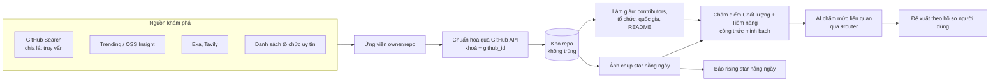

# Kiến trúc OSS Radar

> **Trạng thái: ĐỀ XUẤT — chờ chủ dự án duyệt** (soạn ngày 2026-10-21).
> Mọi lựa chọn dưới đây là quyết định của Claude, chưa phải của chủ dự án. Chỗ nào bị bác thì sửa
> ở đây trước khi làm tính năng thứ hai. Quyết định mới được thêm vào cuối bảng, không xoá dòng cũ
> (đổi trạng thái thành "Thay bởi QĐ-xx").

Mục tiêu của tài liệu: giải thích **vì sao** chọn từng thứ, theo hệ quả vận hành (được gì, tốn gì,
rủi ro gì). Quy tắc làm việc hằng ngày ("làm việc X thì đi đường nào") nằm ở `CLAUDE.md`.

---

## 0. Bảng quyết định

| Mã | Hạng mục | Chọn | Trạng thái |
|---|---|---|---|
| QĐ-01 | Ngôn ngữ | Python 3.13 | Đề xuất, đã dùng |
| QĐ-02 | Môi trường & phụ thuộc | uv + `uv.lock`, cache trong `.cache/uv` | Đề xuất, đã dùng |
| QĐ-03 | Web framework | Django 5.2 LTS | Đề xuất, đã dùng |
| QĐ-04 | Cơ sở dữ liệu | SQLite chế độ WAL, file trong `data/` | Đề xuất, đã dùng |
| QĐ-05 | Giao diện | Template Django render phía máy chủ | Đề xuất, đã dùng |
| QĐ-06 | Gọi dịch vụ ngoài | httpx, chỉ trong `integrations/<dịch vụ>/` | Đề xuất, đã dùng |
| QĐ-07 | Kiểm thử | pytest + pytest-django + respx + pytest-cov (≥ 90%) | Đề xuất, đã dùng |
| QĐ-08 | Chất lượng code | ruff (format + lint) + mypy strict + django-stubs | Đề xuất, đã dùng |
| QĐ-09 | Một lệnh kiểm tra | `uv run poe check` (poethepoet) | Đề xuất, đã dùng |
| QĐ-10 | CI & bảo vệ nhánh | GitHub Actions trên `windows-latest`, action ghim SHA, main chỉ nhận PR có CI xanh | Đề xuất, chờ tạo repo GitHub |
| QĐ-11 | Việc nền & lịch hằng ngày | Huey + SqliteHuey | Dự kiến — chưa cài (xem nợ D-003) |
| QĐ-12 | AI | Gemini qua 9router (chuẩn OpenAI), AI chỉ phân loại/đánh giá | Dự kiến — chưa cài |
| QĐ-13 | Nguồn khám phá phụ | Exa, Tavily | Dự kiến — chưa cài |

---

## 1. Bối cảnh và ràng buộc

- **Một người dùng**, chạy trên máy Windows 11 cá nhân, mở bằng trình duyệt tại `http://127.0.0.1:8000`.
- **Ổ C gần đầy**: dữ liệu, môi trường Python, cache đều nằm trong thư mục dự án trên ổ D.
- **Tài nguyên khan hiếm thật sự là hạn mức API**, không phải CPU:
  GitHub Search 30 lần gọi/phút (khi có token) và trả tối đa 1.000 kết quả cho một truy vấn;
  REST thường 5.000 lần/giờ; Gemini, Exa, Tavily tính theo quota hoặc tiền.
- **Người viết code chủ yếu là AI agent** → ưu tiên công nghệ nhiều tài liệu, có quy ước sẵn, và có máy
  bắt lỗi sớm (kiểu dữ liệu, lint, test) để agent bịa là bị chặn ngay.

---

## 2. Từng lựa chọn và hệ quả

### QĐ-01 — Python 3.13
- **Được:** thư viện crawl, AI, xử lý dữ liệu đầy đủ nhất; máy đã cài sẵn Python 3.13 bản python.org
  (không phải bản Store); bạn đã quen quy trình `.venv`.
- **Tốn:** chạy chậm hơn Go/Rust, nhưng nút thắt là hạn mức API nên không đáng kể.
- **Đã loại:** TypeScript/Node — hợp làm web nhưng hệ sinh thái crawl/AI mỏng hơn; nếu sau cần Python cho
  AI thì phải giữ hai ngôn ngữ.

### QĐ-02 — uv + `uv.lock`
- **Được:** `uv sync` dựng lại môi trường y hệt từ file khoá, trên máy bạn lẫn CI; cài nhanh. Cache đặt ở
  `.cache/uv` cùng ổ D với `.venv` nên uv dùng hardlink thay vì chép file → đỡ tốn dung lượng.
- **Tốn:** cache riêng cho dự án (vài trăm MB khi đủ thư viện).
- **Đã loại:** pip + `requirements.txt` — không khoá phiên bản của thư viện con, dễ xảy ra "máy này chạy,
  máy kia lỗi".

### QĐ-03 — Django 5.2 LTS
- **Được:** mỗi việc phổ biến đã có sẵn **một chỗ theo quy ước**: bảng dữ liệu ở `models.py`, đổi cấu trúc
  CSDL bằng migration tự sinh, đường dẫn ở `urls.py`, kiểm tra dữ liệu nhập bằng Form, việc chạy dòng
  lệnh bằng management command, test có CSDL riêng. Agent ít phải tự nghĩ cấu trúc → ít bịa.
- **Vì sao LTS chứ không phải 6.1 mới nhất:** LTS được vá bảo mật tới 04/2028, API ổn định, ví dụ và tài
  liệu nhiều nhất. Phần Django mà dự án dùng (model, view, form, template, command) gần như không đổi giữa
  các bản. Lên bản LTS kế tiếp (6.2, dự kiến 04/2027) bằng một PR riêng.
- **Tốn:** nặng hơn FastAPI một chút; khởi động khoảng 1 giây.
- **Đã loại:**
  - FastAPI: không có quy ước thư mục/ORM/migration → mỗi agent tự chế một kiểu, càng về sau càng loạn.
  - Next.js: cách làm thay đổi qua từng bản lớn (rủi ro bịa API cao); việc quét chạy lâu không hợp.
  - Ruby on Rails: quy ước mạnh nhất nhưng cài và chạy trên Windows rất cực.

### QĐ-04 — SQLite (WAL) trong `data/`
- **Được:** không cài, không chạy dịch vụ CSDL nào; sao lưu = chép một file; chế độ WAL cho phép vừa đọc
  trên web vừa ghi khi quét. Đủ sức cho hàng triệu dòng (repo + ảnh chụp star hằng ngày).
- **Tốn:** tại một thời điểm chỉ một tiến trình được ghi.
- **Rủi ro & lối thoát:** nếu sau này nhiều worker ghi song song → chuyển PostgreSQL; Django đổi bằng cấu
  hình + `migrate`, code ORM giữ nguyên.
- **Đã loại:** PostgreSQL ngay từ đầu — phải cài và giữ server chạy, thừa cho một người dùng.

### QĐ-05 — Template Django render phía máy chủ
- **Được:** không cần Node, không có bước build, không phải làm API riêng cho giao diện. Mọi trang là HTML
  do Django trả về, test được bằng test client của Django.
- **Khi cần tương tác** (lọc tại chỗ, cập nhật trạng thái quét không tải lại trang): thêm HTMX (một file JS),
  ghi thành quyết định mới trước khi thêm.
- **Đã loại:** React/Vue dạng SPA — gấp đôi lượng code (API + giao diện), gấp đôi chỗ để sai.

### QĐ-06 — httpx, một cửa ra ngoài `integrations/`
- Mỗi dịch vụ ngoài (GitHub, 9router, Exa, Tavily…) có đúng một thư mục client trong
  `integrations/<dịch vụ>/`. Ruff cấm `import httpx` ở mọi nơi khác.
- **Được:** một chỗ duy nhất đặt token, timeout, đếm hạn mức, thử lại; test chặn được mạng tuyệt đối.
  Client trả về kiểu dữ liệu riêng (dataclass), không trả JSON thô → phần còn lại không phụ thuộc định
  dạng của từng hãng.
- **Đã loại:** `requests` (không có timeout mặc định); SDK riêng của từng hãng (mỗi SDK một kiểu lỗi,
  khó giả lập khi test).

### QĐ-07 — Kiểm thử
- pytest + pytest-django. respx giả lập HTTP: một fixture **tự động chặn mọi request thật** trong test
  thường. Test gọi GitHub thật được đánh dấu `live`, chỉ chạy khi gọi riêng (`uv run poe test-live`).
- Dữ liệu giả lập lấy từ **phản hồi thật** của GitHub lưu lại (không tự bịa JSON).
- Độ phủ test tối thiểu 90%; thấp hơn là CI đỏ.
- **Tốn:** viết test chiếm khoảng 40–50% công sức mỗi tính năng. **Được:** agent sửa code về sau không
  phá ngầm tính năng cũ.

### QĐ-08 — ruff + mypy strict
- ruff: một công cụ cho cả định dạng và soát lỗi; bật các luật cấm `print`, cấm comment TODO/FIXME (đường
  tắt phải vào sổ nợ), cấm `import httpx` và đọc biến môi trường sai chỗ.
- mypy strict + django-stubs: agent gọi một hàm/thuộc tính không tồn tại là mypy báo đỏ trước khi chạy →
  chặn kiểu "bịa API" ngay từ máy.
- **Tốn:** phải khai báo kiểu cho mọi hàm (khoảng 10% công gõ).

### QĐ-09 — `uv run poe check`
- Một lệnh duy nhất chạy: kiểm định dạng → soát lỗi → kiểm kiểu → `manage.py check` → kiểm migration đã
  sinh đủ chưa → test + độ phủ. CI chạy **đúng lệnh này**, nên "máy mình xanh" = "CI xanh".
- **Đã loại:** Makefile — Windows không có `make` sẵn.

### QĐ-10 — CI và bảo vệ nhánh
- GitHub Actions chạy trên **windows-latest** để bắt đúng loại lỗi của máy thật: đường dẫn có dấu cách, mã
  hoá tiếng Việt (`PYTHONUTF8=1`).
- Action ghim theo **mã commit (SHA)** thay vì tag: tag có thể bị thay ruột (tấn công chuỗi cung ứng), SHA
  thì không.
- Nhánh `main`: chỉ nhận merge qua Pull Request khi job `check` xanh; cấm force-push, cấm xoá; áp dụng cả
  với chủ repo; chỉ cho squash-merge để mỗi PR là một commit trên main.
- **Tốn:** runner Windows chậm hơn Ubuntu 1–2 phút mỗi lần; với repo private, phút chạy Windows bị tính
  đắt hơn Linux trong hạn mức miễn phí; repo public thì không tính phí.
- **Ràng buộc gói GitHub Free:** bảo vệ nhánh chỉ bật được cho repo **public**. Repo **private** cần gói
  GitHub Pro (khoảng 4 USD/tháng). → Chủ dự án quyết định.

### QĐ-11 — Việc nền và lịch quét hằng ngày (dự kiến)
- Dự kiến dùng **Huey với SqliteHuey**: hàng đợi lưu trong file SQLite (không cần Redis), có lịch định kỳ
  kiểu crontab cho quét hằng ngày, có chế độ chạy ngay (`immediate`) để test.
- **Chưa cài ở nền**: bộ khung chỉ quét một trang (1–2 giây) nên chạy thẳng trong request là đủ — đây là
  nợ có ghi sổ (D-003). Huey hiện ở bản 3.x: phải tra tài liệu bản 3 trước khi dùng.
- Máy tắt đúng giờ quét thì lịch bị lỡ → khi app khởi động, nếu lần quét hằng ngày gần nhất đã quá 24 giờ
  thì chạy bù.
- **Đã loại:** Celery (cần Redis/RabbitMQ, không hỗ trợ Windows chính thức); Task Scheduler của Windows
  (lịch nằm ngoài code, không test được, không nằm trong git).

### QĐ-12 — AI qua 9router (dự kiến)
- Gọi qua 9router (`http://localhost:20128/v1`, chuẩn OpenAI) bằng httpx trong `integrations/llm/` → đổi
  model hay nhà cung cấp chỉ là đổi cấu hình.
- **Vai trò AI bị giới hạn:** (1) mở rộng truy vấn từ nhu cầu của bạn, (2) chấm mức liên quan và tính ứng
  dụng, (3) tóm tắt tiếng Việt. AI **không được tạo số liệu** (star, contributor, tổ chức đứng sau) —
  số liệu luôn lấy từ GitHub API. Mỗi đánh giá của AI được lưu kèm lý do và phiên bản prompt để kiểm lại.

### QĐ-13 — Exa, Tavily (dự kiến)
- Nguồn khám phá phụ: tìm các link `github.com/...` xuất hiện trong bài viết, blog (kể cả blog Trung Quốc)
  mà tìm kiếm của GitHub bỏ sót. Link tìm được đi qua **cùng một đường chuẩn hoá** bằng GitHub API như mọi
  nguồn khác, nên không thể lọt dữ liệu bịa hoặc trùng.

---

## 3. Cấu trúc thư mục theo tính năng

```
config/                  Cấu hình Django (settings, urls gốc). Không chứa nghiệp vụ.
features/
  catalog/               LÕI "kho repo": bảng Repository, hàm ghi không trùng. Nơi duy nhất ghi bảng này.
  discovery/             F-001 Quét theo truy vấn (tính năng mẫu — mọi tính năng sau copy cấu trúc này)
    models.py            Bảng của tính năng
    services.py          Toàn bộ nghiệp vụ
    forms.py             Kiểm tra dữ liệu người dùng nhập
    views.py, urls.py    Lớp web mỏng: nhận request → gọi service → render
    templates/discovery/ Giao diện
    management/commands/ Lệnh dòng lệnh (cho lịch chạy và cho agent tự kiểm chứng)
    tests/               Test của riêng tính năng
integrations/
  github/                Client GitHub. Không biết gì về Django model.
templates/base.html      Khung trang chung
static/css/app.css       CSS chung
tests/                   Test toàn dự án (lính gác quy tắc: sổ nợ, bản đồ tính năng…)
docs/ARCHITECTURE.md     Tài liệu này
CLAUDE.md                Luật làm việc cho agent
FEATURE_MAP.md           Bản đồ tính năng (cập nhật cùng PR với tính năng)
DEBT.md                  Sổ nợ có chủ đích
```

**Chiều phụ thuộc (một chiều, không vòng):**

```
views / urls / management commands  →  services  →  models (của mình hoặc của catalog)
                                                 →  integrations/*
integrations/*  →  (không import features, không import Django model)
```

- Tính năng A dùng tính năng B **chỉ qua `B.services`** (ngoại lệ: được trỏ ForeignKey tới model của B).
- `features/catalog` là nơi duy nhất ghi bảng `Repository`.

---

## 4. Luồng dữ liệu đích của sản phẩm



Bộ khung F-001 đi xuyên một lát mỏng của luồng này:
**GitHub Search (1 trang) → chuẩn hoá → kho repo không trùng → hiển thị sắp theo star.**

---

## 5. "Tìm đúng, tìm đủ" — kiến trúc chống rác (định hướng cho các tính năng sau)

- **Đủ:** chia lát truy vấn theo khoảng ngày tạo và khoảng star để vượt trần 1.000 kết quả/truy vấn; kết
  hợp nhiều nguồn; mỗi lát quét ghi lại "GitHub báo bao nhiêu / đã lấy bao nhiêu" để biết chỗ nào còn sót.
- **Không trùng:** khoá chính là `github_id` — không đổi khi repo đổi tên hay chuyển chủ.
- **Đúng:** số liệu chỉ từ API chính thức; điểm số có bảng giải thích từng thành phần; lọc rác bằng luật
  cứng trước (fork, archived, không có code, star tăng bất thường…), AI chỉ xếp hạng phần còn lại.
- **Ưu tiên repo Trung Quốc:** tín hiệu từ vị trí (location) của chủ repo/tổ chức, ngôn ngữ README, danh
  sách tổ chức uy tín (ví dụ Alibaba, Tencent, ByteDance, Baidu, Zhipu, DeepSeek, ModelScope, OpenBMB,
  Shanghai AI Lab). Danh sách là **dữ liệu cấu hình** bạn sửa được, không viết cứng trong code.

---

## 6. Điểm cần chủ dự án quyết

1. Repo GitHub **public** (bảo vệ nhánh miễn phí, ai cũng xem được code) hay **private** (cần GitHub Pro để
   có bảo vệ nhánh).
2. Tên dự án `oss-radar` (giao diện hiển thị "OSS Radar") có được không.
3. "Nguyên tắc thiết kế kiểu Dune" trong `CLAUDE.md` là cách Claude diễn giải (không tìm thấy nguồn định
   nghĩa chuẩn); nếu bạn có nguồn cụ thể thì sửa theo nguồn đó.
